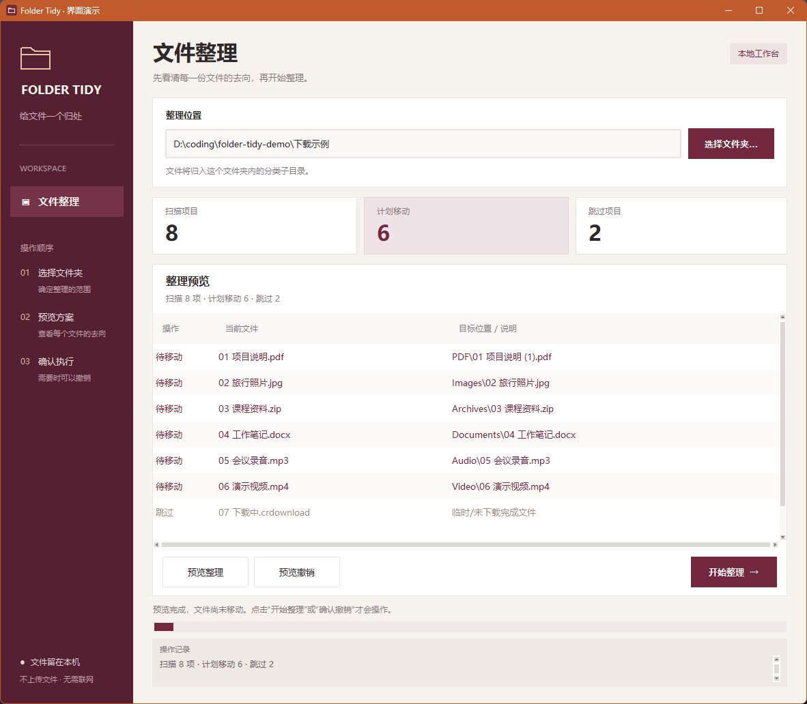

# Folder Tidy · 文件整理助手

下载文件夹里，PDF、照片和压缩包混在一起，找文件越来越费劲。Folder Tidy 是一个 Windows 本地文件整理工具：选中目录，先查看每个文件的整理去向，确认后再按类型归类；整理后也能撤销。

**先预览，再整理；同名保留双方，撤销保护新增文件。**

[下载 Windows 版](https://github.com/XuFugui3411/folder-tidy/releases/latest) · [使用说明](docs/使用说明.txt)

## 界面预览



截图使用演示文件，展示实际运行的整理预览；尚未执行文件移动。

## 可以做什么

- **按类型归类**：PDF、图片、压缩包、文档、音频、视频和代码分别放入原目录内的分类文件夹。
- **看清楚再执行**：列表逐项显示文件名和目标位置，同时统计扫描、计划移动和跳过的数量。
- **保留同名文件**：已有同名目标时自动添加编号，不覆盖原文件。
- **撤销最近一次整理**：根据操作记录逐项还原。遇到新增文件或内容修改时报告冲突，保留现场。
- **失败继续处理**：单个文件被占用或无法访问时说明原因，继续处理其他文件。
- **本机离线使用**：文件不上传，发布包无需安装 Python，并提供创建桌面启动图标的入口。

## 三步开始使用

1. 下载 Windows ZIP，完整解压后双击 **安装到桌面.cmd**，桌面会出现“文件整理助手”图标。
2. 打开软件，点击 **选择文件夹 → 预览整理**，检查文件将被移动到哪里。
3. 点击 **开始整理**。需要撤回时，选择同一目录，点击 **预览撤销 → 确认撤销**。

支持 Windows 10 / 11 的 64 位系统；当前整理目录需要支持硬链接，例如本地 NTFS。只整理所选目录的第一层，已有子目录会跳过。

## 下载即用（Windows 10 / 11，64 位）

在 [Releases 下载页](https://github.com/XuFugui3411/folder-tidy/releases/latest) 下载 `FolderTidy-1.0.0-windows-x64.zip`，完整解压后双击 **安装到桌面.cmd**。

安装会把软件复制到当前用户的固定目录，并在桌面创建 **文件整理助手** 启动图标。之后可删除下载包和解压目录，直接从桌面打开。无需安装 Python、无需联网、无需管理员权限。

也可直接运行解压目录中的 `FolderTidy.exe` 便携使用；此方式需保留整个软件文件夹，不创建桌面图标。

GitHub 的 **Code → Download ZIP** 和自动生成的 **Source code (zip)** 是源码包；普通使用者请下载上面指定的 Windows 运行包。

安装位置为 `%LOCALAPPDATA%/Programs/FolderTidy/versions`。卸载时先关闭软件，再删除桌面快捷方式与软件安装目录。具体操作见 [使用说明](docs/使用说明.txt)。

## 从源码运行

### 源码窗口版

Windows 上双击 **`启动文件整理助手.cmd`**。也可以双击 `启动文件整理助手.pyw`（需要系统已关联 Python），或运行 `python folder_tidy_gui.py`。

1. 点击“选择文件夹…”，选中要整理的目录。
2. 点击“预览整理”，表格会显示每个文件的目标位置及跳过原因；此时不移动文件。
3. 看完后点击“开始整理 →”。文件放入原文件夹内的分类目录，实际结果显示在下方日志中。
4. 想撤回时，选择同一文件夹，点击“预览撤销”，再点击“确认撤销”。可以关闭软件后重新打开撤销，记录保存在目标目录中。

只有完成相应预览后，执行按钮才可用。更换路径、完成一次操作后，都需要重新预览。若预览后文件夹内容或历史记录变化，执行会停止并要求重新预览。撤销时若原位置新增文件或归类文件已修改，底层核对会报告冲突并保护文件。

窗口采用勃艮第红侧栏、暖白工作区，独立显示扫描、计划移动及跳过统计。整理与撤销使用对应的主操作按钮，表格交替行底色及状态颜色帮助核对文件去向。

扫描及文件操作在后台线程进行，界面保持响应；运行期间禁止重复点击操作和关闭窗口。窗口版使用 Python 自带的 Tkinter，标准 Windows Python 安装通常包含此组件；需要保留同目录的 Python 源文件，该要求仅针对源码运行；Windows 发布包已包含运行环境。

## 使用

在 PowerShell 中运行（将示例路径替换为自己的文件夹）：

```powershell
# 预览：不移动文件、不创建目录或日志
python folder_tidy.py "D:\下载 文件夹"

# 执行：显示方案，然后实际移动
python folder_tidy.py "D:\下载 文件夹" --execute

# 预览最近一次整理的撤销方案
python folder_tidy.py "D:\下载 文件夹" --undo

# 实际撤销
python folder_tidy.py "D:\下载 文件夹" --undo --execute
```

Windows 也可调用同目录的 `folder-tidy.cmd`，参数相同。其他系统直接运行 Python 脚本。

## 规则

- 仅扫描指定文件夹的第一层。已有子目录、符号链接、Windows 目录联接等重解析点均跳过，不递归整理。
- 按扩展名（不区分大小写）归入 `PDF`、`Images`、`Archives`、`Documents`、`Audio`、`Video`、`Code`；未识别的扩展名和无扩展名文件归入 `Others`。
- `.tmp`、`.part`、`.crdownload`、`.download` 文件跳过。
- 同名目标自动变为 `报告 (1).pdf`、`报告 (2).pdf` 等。移动时再次检查；即使随后出现同名文件，底层操作也会拒绝覆盖。
- 输出“扫描项数 / 计划移动 / 跳过”，执行时另报实际成功和失败数。扫描项数包括第一层目录等跳过项，不包括工具自己的 `.folder-tidy` 状态目录。
- 单个文件访问、读取、移动失败，会显示原因并继续。日志写入失败则停止后续操作，避免出现没有恢复记录的移动。
- 退出码：`0` 正常（含无文件可移动），`1` 操作失败或撤销冲突，`2` 参数错误，`130` 用户中断。跳过项本身不算执行失败。

## 撤销和记录

每次执行均在待整理目录的 `.folder-tidy` 中创建独立 UTF-8 JSON 日志。日志先记录移动意图并刷盘，再操作文件，之后更新状态。撤销也在操作前后更新状态，中断后的记录可以重试。

`--undo` 选择最近一次仍有待恢复文件的整理。空操作或全部失败的操作不会遮住之前可撤销的记录。完成一次撤销后，再调用可撤销更早一次；存在未解决冲突时，重试仍针对同一记录。

撤销核对设备、文件 ID、大小、修改时间和 SHA-256：

- 原位置出现新文件时，保留两边，报告冲突；不会覆盖、改名或删除新文件。
- 归类后的文件被修改、替换、删除或外部移动时，保留现场，报告冲突。时间戳变化也会保守地视为冲突。
- 其他不冲突的文件继续恢复。解除冲突后可重试，例如先自行移开原位置的新文件。
- 只还原日志列出的文件，保留分类目录（包括空目录），不会递归删除目录。因此整理后新增的文件不会被清理。

请保留 `.folder-tidy`，不要手工修改日志。不要在运行期间由其他程序移动、替换或修改同一批文件。工具会检测多种变化，并对自身的并发执行加锁，但无法给其他软件加锁。此日志用于操作恢复，不代替备份，也不承诺断电时文件系统元数据的持久性。

## 文件系统要求

工具使用同文件系统的“创建硬链接 → 删除原目录项”实现移动：保留原文件身份和元数据，创建目标时原子地拒绝覆盖。当前实现需要支持硬链接的文件系统（例如本地 NTFS）。FAT/exFAT 或限制硬链接的网络盘会报告移动失败并保留原文件。没有复制后删除的降级路径。

预览只读取目录信息；执行及撤销会读取文件以核对 SHA-256，大文件会耗时。常见占用文件行为取决于操作系统和共享权限：系统拒绝访问/删除时记录失败；允许操作的打开文件可以正常移动。

## 验证

```powershell
cd folder-tidy
python -m unittest discover -s tests -v
```

测试使用临时目录，不触碰真实下载目录。覆盖中文与空格、默认无写入、同名目标和晚到冲突、重复运行、历史顺序、撤销预览、新增文件、修改/替换检测、单文件失败后继续、源删除失败、写日志失败、中断恢复、并发锁及不安全日志路径。Windows 上另用 `CreateFileW` 的独占句柄验证真实文件占用，并验证目录联接跳过；符号链接测试在系统不允许创建时明确跳过。

## 构建发布包

在 Windows x64 上，用 Python 3.11 执行：

```powershell
python -m pip install -r requirements-build.txt
python -m unittest discover -s tests -v
python tools/build_release.py
```

`releases/` 中会生成 Windows 便携 ZIP、干净的源码 ZIP 和 SHA256SUMS.txt。应用代码只使用标准库，PyInstaller 仅用于构建。构建脚本会运行打包后 EXE 的临时文件整理、撤销及 Tk 窗口检查，成功后才生成 ZIP。

推送 main 分支、版本标签或在 Actions 中手动运行 Build Windows release，都会执行测试和构建。当前版本尚无 Release 时，自动创建版本标签并发布附带 ZIP 的 Release；已有版本保留原下载文件。更新发布前请同步修改版本号与发布说明。
